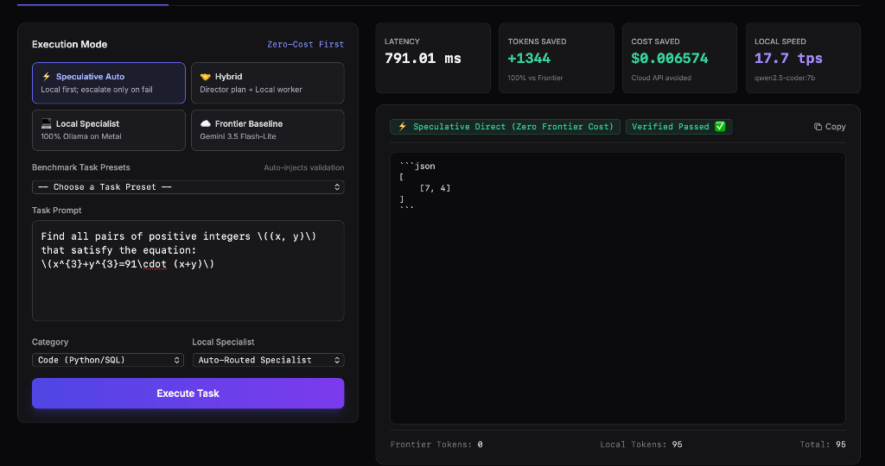

# Antigravity Director (Frontier + Local Model Orchestration)

A hybrid AI architecture and benchmarking framework that couples a **Frontier Model** (acting as Director, Planner, and Judge) with **local MLX/Metal-accelerated Ollama models** (acting as high-throughput task workers) to optimize token savings, latency, cost, and accuracy.

<p align="center">
  
</p>

```
                           ┌────────────────────────┐
                           │   Task / Problem Spec  │
                           └───────────┬────────────┘
                                       ▼
                          ┌─────────────────────────┐
                          │    Director (Frontier)  │
                          │   Compact Task Planning │
                          └────────────┬────────────┘
                                       │ Specialized Instruction
                                       ▼
                          ┌─────────────────────────┐
                          │   Local Worker (Ollama) │
                          │  Heavy Payload Gen (MLX)│
                          └────────────┬────────────┘
                                       ▼
                          ┌─────────────────────────┐
                          │    Verification Engine  │
                          │ Deterministic / Judge   │
                          └──────┬───────────┬──────┘
                                 │ Pass      │ Fail
                                 │           ▼
                                 │      ┌───────────────────────┐
                                 │      │ Fallback to Frontier  │
                                 │      └───────────┬───────────┘
                                 ▼                  │
                          ┌─────────────────────────▼┐
                          │    Final Synthesis &     │
                          │   Telemetry Aggregator   │
                          └──────────────────────────┘
```

---

## Key Features

1. **Frontier Token Savings & Cost Reduction**:
   - The Frontier model is only used for concise routing plans (~50 tokens) and final verification (~50 tokens).
   - The heavy lifting (300–1000 tokens) is offloaded to local Ollama workers (`$0.00` API cost).
   - Generates 75%–90% reduction in frontier token usage.

2. **Automated Verification & Fallback Escalation**:
   - Deterministic test harness (unit test assertion, JSON schema, or code execution).
   - If local execution fails validation, the Director automatically escalates the subtask to the Frontier model for self-correction.

3. **System & Resource Profiler**:
   - Measures exact RAM consumption, memory delta (MB), CPU %, latency (ms), and local generation throughput (tokens/sec).
   - Real-time hardware telemetry using `psutil` on Apple Silicon.

4. **Turnkey Comparative Benchmarking & 4 Execution Modes**:
   - Runs side-by-side trials:
     - `Mode 1: Frontier-Only Baseline` (Gemini 3.5 Flash-Lite)
     - `Mode 2: Local-Only Baseline` (Ollama on Metal GPU)
     - `Mode 3: Hybrid Orchestration` (Director Planner + Specialist Worker)
     - `Mode 4: Adaptive Speculative Routing` (Zero-Cost First: runs local specialist directly, escalating to Frontier Director only upon test failure — achieving up to 100% token savings!)
   - Generates comparative tables and exports full telemetry to JSON.

5. **Interactive Visual Web Dashboard**:
   - Real-time dark-mode SPA served directly via Python standard library.
   - Live Apple Silicon Wired RAM (Metal GPU memory) and CPU gauges.
   - Interactive prompt lab with quick-select benchmark presets and live token breakdown.
   - Interactive Pareto Frontier (Cost vs. Latency vs. Accuracy) and token consumption charts.

---

## Quickstart

### 1. Requirements
- Python 3.9+
- Ollama installed and running (`ollama serve` or Ollama.app)
- Gemini API Key in `.env` (optional, simulated fallback enabled offline)

### 2. Setup
```bash
python3 -m venv .venv
source .venv/bin/activate
pip install -r requirements.txt
```

### 3. Launch the Interactive Web Dashboard
```bash
python3 -m director.cli serve --port 8501
```
Open **[http://127.0.0.1:8501](http://127.0.0.1:8501)** in your browser!

### 4. CLI Commands
```bash
# Check local Ollama models and target specialists
python3 -m director.cli models

# Run a task interactively
python3 -m director.cli run "Write a python function is_palindrome(s: str) -> bool"

# Run the comparative benchmark suite
python3 -m director.cli benchmark --model auto --export specialist_benchmark.json
```

---

## Project Structure

```
├── director/
│   ├── __init__.py
│   ├── config.py              # Configuration & token pricing tables
│   ├── profiler.py            # Hardware & token telemetry tracking
│   ├── ollama_worker.py       # Async Ollama client with token/duration metrics
│   ├── frontier_client.py     # Frontier director client (Gemini / Simulated)
│   ├── orchestrator.py        # Hybrid Director execution & fallback logic
│   ├── benchmark_tasks.py     # Deterministic code, math, and JSON extraction tasks
│   ├── runner.py              # Benchmark execution engine & summary aggregation
│   └── cli.py                 # Rich interactive terminal interface & dashboard
├── tests/
│   └── test_director.py       # Pytest unit tests for all components
├── requirements.txt
└── README.md
```
